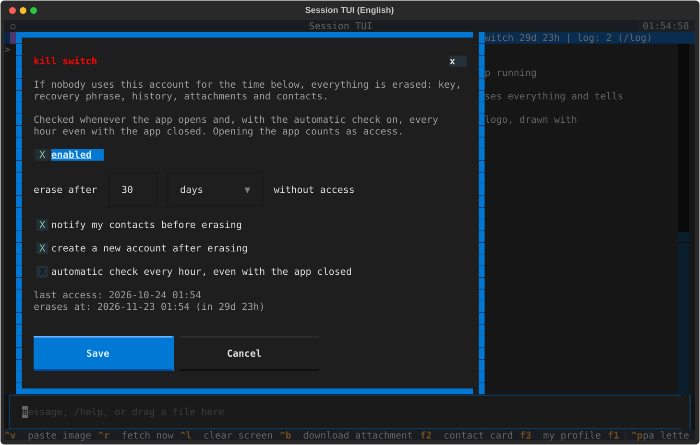

<p align="center">
  
</p>

<h1 align="center">Session TUI — Windows</h1>

<p align="center">
  A native <a href="https://getsession.org">Session</a> messenger client for the terminal.<br>
  Your own account, end-to-end encryption, images, onion routing and a configurable kill switch —<br>
  without the official app running.
</p>

<p align="center">
  
  
  
  
  
</p>

<p align="center"><b>English</b> · <a href="README.pt-BR.md">Português</a> · <a href="https://github.com/ToDyNh0/SESSION-TUI_lnx">Linux version</a></p>

> [!IMPORTANT]
> **Unofficial project.** Session TUI is an independent, educational client. It is not affiliated
> with, endorsed by or supported by Session, the Session Technology Foundation or the Oxen/OPTF
> projects. It talks to the public Session network using the open protocol; respect the network's
> terms and do not use it for spam.

<p align="center"></p>

## Contents

- [Highlights](#highlights)
- [Screenshots](#screenshots)
- [Quick start](#quick-start)
- [Using it](#using-it)
- [Kill switch](#kill-switch)
- [Language](#language)
- [Password protection](#password-protection)
- [Images and files](#images-and-files)
- [Where your data lives](#where-your-data-lives)
- [Security model and limits](#security-model-and-limits)
- [How it works](#how-it-works)
- [Project layout](#project-layout)
- [Tests](#tests)
- [Troubleshooting](#troubleshooting)

## Highlights

| | |
| --- | --- |
| **Your own account** | Creates the keys locally (Ed25519 → X25519, `05…` Session ID). The 13-word recovery phrase uses the same format as the official app. |
| **End-to-end encryption** | Sealed box + Ed25519 sender signature, padded to 160 bytes — Session Protocol v2, 1-to-1. |
| **Direct or onion** | Talk to the service nodes directly, or through 3 encrypted hops so no node sees both ends. |
| **Images and files** | Up to 10 MB, encrypted before upload. Reads both attachment formats (classic AES-CBC+HMAC and the new `crypto_secretstream`). Pictures are drawn **inside the terminal**. |
| **Kill switch** | After N hours / days / months / years without access it erases everything, can notify your contacts and can create a fresh account. |
| **Password on disk** | Optional: the seed is encrypted with Argon2id + XChaCha20-Poly1305. |
| **English and Portuguese** | English by default; one command switches it. |
| **One file** | `build.bat` (or Docker) produces a single `session-tui.exe` that runs without Python. |
| **Windows-native** | Task Scheduler for the kill switch, `icacls` on the key file, `clip.exe`, data in `%APPDATA%`. |

## Screenshots

<table>
  <tr>
    <td width="50%"><br><sub><b>First run</b> — the account is created locally and the recovery phrase is shown once.</sub></td>
    <td width="50%"><br><sub><b>Kill switch</b> — time without access, notify contacts, new account, automatic check.</sub></td>
  </tr>
  <tr>
    <td><br><sub><b>My profile</b> (<kbd>F3</kbd>) — display name, Session ID, phrase, password, kill switch, language.</sub></td>
    <td><br><sub><b>Contact card</b> (<kbd>F2</kbd>) — full ID, nickname, copy, remove.</sub></td>
  </tr>
  <tr>
    <td><br><sub><b>Help</b> (<kbd>F1</kbd>) — every command, by section.</sub></td>
    <td><br><sub><b>Português</b> — the whole interface, translated.</sub></td>
  </tr>
</table>

<p align="center"></p>

## Quick start

You need **one** of: Python 3.10+, or Docker. Nothing else.

### Option A — build the `.exe` with one script

```bat
git clone https://github.com/ToDyNh0/SESSION-TUI_win.git
cd SESSION-TUI_win
build.bat test
```

`build.bat` creates a private virtual environment (`.venv`), installs the dependencies, runs the
offline tests (`test`) and builds **`dist\session-tui.exe`** — a single file that runs on any
64-bit Windows 10/11 without Python. Copy it anywhere and run it:

```powershell
.\dist\session-tui.exe            # opens the TUI
.\dist\session-tui.exe --help     # all commands
```

### Option B — build the `.exe` in Docker (no Python on the host)

```bash
docker build --output dist .
```

The [`Dockerfile`](Dockerfile) runs Windows Python under Wine: it installs the dependencies, runs the
whole test suite **with that Windows Python** and builds `dist/session-tui.exe`. It works from
Windows (Docker Desktop, Linux containers), Linux or macOS.

### Option C — run from source, no build

```bat
run.bat                       :: opens the TUI (first run installs everything into .venv)
run.bat send 05ab... "hi"     :: any command
```

## Using it

The first time you open it, a new account is created and the **recovery phrase** is shown. Write
it down on paper: it *is* the account.

The examples below use `session-tui`; from source use `run.bat` instead.

### The TUI

```text
session-tui                    # open the TUI (creates the account the first time)
session-tui tui --to 05ab...   # open it straight on a conversation
```

Each contact has **its own screen**: switching conversations clears the panel and redraws only that
history. Messages from another conversation do not mix in — they become an unread counter in the
list (`alice (2)`) and a toast notification.

| Shortcut | What it does |
| --- | --- |
| <kbd>F1</kbd> | help, in a scrollable window |
| <kbd>F2</kbd> / right click on the list | contact card |
| <kbd>F3</kbd> / click on your avatar | your profile: name, ID, phrase, password, kill switch, language |
| <kbd>Ctrl</kbd>+<kbd>R</kbd> | fetch messages now (it also polls every 5 s) |
| <kbd>Ctrl</kbd>+<kbd>V</kbd> / <kbd>Ctrl</kbd>+<kbd>G</kbd> | send the image in the clipboard |
| <kbd>Ctrl</kbd>+<kbd>B</kbd> | download the received attachment |
| <kbd>Ctrl</kbd>+<kbd>L</kbd> | clear the panel |
| <kbd>Ctrl</kbd>+<kbd>C</kbd> | quit |

Any line that does not start with `/` is sent as a message. Commands (Portuguese aliases in brackets):

| Command | What it does |
| --- | --- |
| `/to <session_id>` (`/para`) | open or create a conversation |
| `/add <session_id>` | add to the list without switching |
| `/profile [id]` (`/perfil`) | contact card |
| `/nick <name>` (`/apelido`) · `/rm [id]` | nickname · remove from the list |
| `/name <name>` (`/nome`) | your display name, sent with your messages |
| `/me` (`/eu`) · `/phrase` (`/frase`) | your profile · show the recovery phrase |
| `/file <path> [caption]` (`/img`, `/arquivo`) | send an image or any file |
| `/download [n]` (`/baixar`) · `/auto on\|off` | download an attachment · download without asking |
| `/open [path]` (`/abrir`) · `/view <path>` (`/ver`) | open in the default app · draw an image |
| `/mode [half\|blocks]` (`/modo`) · `/width <n>` (`/largura`) | image drawing mode · size |
| `/protect` · `/unprotect` | password on the seed |
| `/killswitch` (`/ks`) | kill switch settings |
| `/lang en\|pt` (`/idioma`) | interface language |
| `/onion on\|off` · `/network` (`/rede`) | onion routing · network diagnostics |
| `/log [n\|clear]` · `/typing` | network log · send "typing…" |
| `/removeall` | erase everything and start a new account (asks twice) |
| `/help` (`/ajuda`) · `/quit` (`/sair`) | help · quit |

### Command line

Every feature also works without the TUI — handy for scripts. Portuguese names work as aliases.

| Command | What it does |
| --- | --- |
| `session-tui new` (`nova`) | create an account and show the phrase |
| `session-tui import "13 words"` (`importar`) | recover an account |
| `session-tui me [--phrase]` (`eu`) | show your Session ID (and phrase) |
| `session-tui send <id> "text"` (`enviar`) | send a message and exit |
| `session-tui file <id> photo.png [caption]` (`imagem`) | send an image or file and exit |
| `session-tui listen [--once]` (`ouvir`) | print incoming messages, saving attachments |
| `session-tui view photo.png` (`ver`) | draw an image in the terminal |
| `session-tui network [--to <id>]` (`rede`) | nodes, swarms and network clock |
| `session-tui protect` / `unprotect` | password on the seed |
| `session-tui killswitch [on\|off\|status\|install\|uninstall\|check]` (`ks`) | kill switch |
| `session-tui lang [en\|pt]` (`idioma`) | interface language |
| `session-tui test [--network]` (`testes`) | protocol tests (offline, or a real round trip) |

Global options, accepted before or after the command: `--profile DIR`, `--onion`, `-v`,
`--password PASSWORD`, `--lang en|pt`.

## Kill switch

If nobody uses the account for the time you choose, **everything is erased**: the key, the recovery
phrase, the history, the attachments and the contact list.

<p align="center"></p>

| Setting | Options |
| --- | --- |
| Time without access | any number of **hours, days, months or years** (1 hour to 100 years) |
| Notify my contacts | before erasing, sends every contact `I am moving my account to:<new ID>` — or `This account is no longer in use.` when no new account is created |
| Create a new account | after erasing, creates a fresh account right away (its phrase is shown the next time you open the app) |
| Automatic check | checks every hour through the **Windows Task Scheduler**, **even with the app closed** |

From the TUI: <kbd>F3</kbd> → **Kill switch**, or `/killswitch`. From the command line:

```bash
session-tui killswitch on --after 30 --unit days --notify --new-account   # also installs the hourly check
session-tui killswitch status
session-tui killswitch off                                                # also removes the hourly check
```

`--unit` accepts `hours`, `days`, `months`, `years` (and `horas`, `dias`, `meses`, `anos`). Use
`--no-notify`, `--no-new-account` or `--no-schedule` to turn the options off.

**What counts as access:** opening the account (TUI or any command that uses it) and, while the TUI is
open, using it — the timer is refreshed every few minutes. Only the account owner can change the
setting: with a password-protected account, `killswitch on/off` asks for the password.

**When it is checked:** every time the app starts (before anything else — even `killswitch off` cannot
skip a deadline that already passed), and every hour by the scheduler when the automatic check is
installed. When it fires, the next time you open the app it tells you what happened. Each firing is
also recorded in `killswitch.log` in the profile folder (never the old account).

**The automatic check on Windows** is a Task Scheduler task named `SessionTUI-killswitch-<id>`, for
your user only (no administrator rights), every hour, also on battery, and *hidden* — it runs
`conhost.exe --headless session-tui.exe killswitch check` (or `pythonw.exe main.py …` from source),
so no window ever flashes. See it with `schtasks /Query /TN SessionTUI-killswitch-<id>`.

> If you move `session-tui.exe` (or the source folder) after installing the check, run
> `session-tui killswitch install` again so the task points to the new place.

> [!WARNING]
> **Limits — read before trusting it.**
> - A **password-protected** account **cannot notify** contacts when the switch fires: the key that
>   signs the notice is encrypted and the scheduler does not know the password. It is still erased.
> - Anyone who **copied** your files before the deadline keeps the copy.
> - Files are overwritten with random bytes before deletion, but on SSDs, copy-on-write file systems
>   or cloud-synced folders that does not guarantee the old bytes are gone.
> - Someone who controls the computer can change the clock or the settings file.

## Language

English is the default. Switch it — the choice is saved in the profile:

```bash
session-tui lang pt        # Português
session-tui lang en        # English
session-tui --lang pt me   # only for this run
```

In the TUI: `/lang pt` or the language button in your profile (<kbd>F3</kbd>). Menus and shortcuts
change the next time the app opens. Error messages from the network layer are translated too, and
the test suite checks that every text has a Portuguese translation.

## Password protection

The recovery phrase **is** the account: whoever has it becomes you. By default it is stored in clear
text in `account.json` (readable only by your Windows user: the file gets its own ACL via `icacls`). To encrypt it:

```bash
session-tui protect        # asks for the password (or /protect in the TUI)
```

```text
password --Argon2id(salt, 3 passes, 256 MB)--> 32-byte key
seed + phrase --XChaCha20-Poly1305(key, nonce)--> encrypted block
```

After that `account.json` only has the encrypted block, salt, nonce and Argon2id parameters. The
Session ID stays readable on purpose (it is your public address). The TUI then asks for the password
when it opens; commands ask on the terminal or accept `--password` (which stays in the shell history
— prefer the prompt). There is **no password recovery**: only the 13 words bring the account back.
`session-tui unprotect` reverses it.

## Images and files

| Action | How |
| --- | --- |
| send | drag the file into the terminal and press Enter, or `/file <path> [caption]` |
| paste | copy an image and press <kbd>Ctrl</kbd>+<kbd>V</kbd> (or <kbd>Ctrl</kbd>+<kbd>G</kbd>) |
| receive | the conversation shows name, size and dimensions and **asks**; <kbd>Ctrl</kbd>+<kbd>B</kbd> downloads |
| open | `/open` opens the last download in the default app |

Any file type up to 10 MB. Files are encrypted on your machine before they reach the file server,
which only stores random-looking bytes for about two weeks.

| Drawing mode | What it is | Where |
| --- | --- | --- |
| `half` (default) | two pixels per cell with ANSI colors | any terminal |
| `blocks` | one pixel per cell | terminals that paint backgrounds badly |
| `sixel` | real pixels, Sixel protocol | Windows Terminal 1.22+, WezTerm |
| `tgp` | real pixels, Kitty graphics protocol | Kitty, Ghostty |
| `auto` | probes the terminal and picks one | — |

`sixel`, `tgp` and `auto` must probe the terminal before the interface opens, so they are chosen at
start: `session-tui tui --mode sixel`.

## Where your data lives

The profile folder is **`%APPDATA%\SessionTUI\profile`** (choose another with `--profile DIR`).

| File | Content |
| --- | --- |
| `account.json` | the account seed — **the private key** (encrypted if you used `protect`) |
| `state.json` | contacts, nicknames, display name, polling position |
| `config.json` | language, kill switch settings and last access (kept when everything is erased) |
| `history.jsonl` | local conversation history (clear text) |
| `attachments/`, `enviados/` | downloaded and pasted files |
| `snodes.json` | cache of the service node list |
| `killswitch.log` | one line per kill switch firing |

It is outside the program folder and outside OneDrive on purpose: a synced folder would upload your private key to the cloud.

## Security model and limits

- **Content** is end-to-end encrypted; service nodes and the file server only see ciphertext.
- **Direct mode:** the service node and the file server see your IP. **`--onion`:** no node sees
  both ends, also for attachments — at the cost of latency.
- The service nodes' TLS certificates are self-signed, so TLS is not verified. Their real identity is
  the Ed25519/X25519 key published on the network, which is what onion mode encrypts to.
- `history.jsonl` and `attachments/` are clear text even with a password. While the program runs,
  the key is in memory.
- Out of scope: groups, communities, calls, profile/contact sync between devices, disappearing
  messages and push notifications. 1-to-1 conversations with `05…` IDs only.
- Writing to someone who uses the official app for the first time arrives as a **message request**
  they need to accept.

## How it works

| Step | Where | What happens |
| --- | --- | --- |
| 1. Keys | `session_native/keys.py`, `mnemonic.py` | 16-byte seed → Ed25519 → X25519; `Session ID = "05" + X25519 pubkey`; 13-word phrase with CRC-32 checksum |
| 2. Service nodes | `session_native/snode.py` | `get_n_service_nodes` on the seed nodes → ~1,200 nodes cached; RPC on `POST /storage_rpc/v1` |
| 3. Onion routing | `session_native/onion.py` | 3 XChaCha20-Poly1305 layers, hop key `blake2b(X25519(a,B) ‖ A ‖ B)`, `POST /onion_req/v2` |
| 4. Swarm | `session_native/snode.py` | `get_swarm` → `store` (namespace 0) and signed `retrieve` |
| Attachments | `session_native/attachments.py` | AES-256-CBC + HMAC-SHA256 upload; download of both formats, also over onion v4 |

The full description of the message format, padding, signatures and attachments is in
**[docs/PROTOCOL.md](docs/PROTOCOL.md)**.

## Project layout

```text
main.py                    command line (every command)
tui.py                     the live interface (Textual)
imgview.py                 drawing images, clipboard, dragged paths
selftest.py                offline tests and the real-network round trip
build_exe.py               PyInstaller options shared by the scripts and Docker
build.bat, run.bat           build the .exe / run from source
Dockerfile                 cross-builds the .exe with Windows Python under Wine
assets/                    logo (ASCII art and image) and the .exe icon
docs/                      protocol notes and screenshots
session_native/
  sistema.py               everything that depends on the OS (Windows version)
  killswitch.py            kill switch: settings, deadline, firing
  i18n.py, traducao_pt.py  interface texts: English and Portuguese
  cofre.py                 password -> Argon2id -> XChaCha20 over the seed
  keys.py, mnemonic.py     seed, Ed25519/X25519, Session ID, 13-word phrase
  proto.py, wire.py        minimal protobuf, padding, sealed box, envelopes
  snode.py, onion.py       service nodes, swarms, onion requests
  attachments.py           attachment crypto and the file server
  client.py                high-level API: send_text() / send_file() / poll()
  profile.py               account, state, config, history on disk
  logo.py                  the ASCII logo
```

The code is identical in [SESSION-TUI_win](https://github.com/ToDyNh0/SESSION-TUI_win) and
[SESSION-TUI_lnx](https://github.com/ToDyNh0/SESSION-TUI_lnx) except for `session_native/sistema.py`
and the build files.

## Tests

```bash
session-tui test            # offline: 25 checks, a few seconds
session-tui test --network  # also a real round trip: two throwaway accounts send a message and an image
```

<p align="center"></p>

The offline suite covers the phrase ↔ Session ID round trip, padding, sender authentication, that a
third party cannot decrypt, tampering detection, protobuf field numbers, both attachment formats,
dragged paths, the password vault, the kill switch (firing, notice skipped with a password, units,
limits) and that every interface text is translated. The builds (`build.bat` `test` and the
Dockerfile) run it before producing the executable.

## Troubleshooting

| Problem | Fix |
| --- | --- |
| *"Windows protected your PC"* (SmartScreen) | The `.exe` is not code-signed. Click **More info → Run anyway**, or build it yourself from source — it is the same file. |
| An antivirus flags the `.exe` | PyInstaller executables sometimes trigger heuristics. The build does **not** use UPX packing (a common trigger). Build it yourself, or run from source with `run.bat`. |
| <kbd>Ctrl</kbd>+<kbd>V</kbd> pastes text instead of the image | Windows Terminal keeps <kbd>Ctrl</kbd>+<kbd>V</kbd> for itself: use <kbd>Ctrl</kbd>+<kbd>G</kbd> or `/paste`. |
| Right click pastes instead of opening the card | Windows Terminal uses right click to paste: use <kbd>F2</kbd> or `/profile`. |
| `build.bat` says Python is missing | Install Python 3.10+ from python.org and tick *Add python.exe to PATH* (or use the Docker build). |
| Real images (`--mode sixel`) | Need Windows Terminal 1.22 or newer; `half` works everywhere, `cmd.exe` included. |
| The account was in the old `session_profile` folder | Use it with `--profile path\to\session_profile`, or copy its files into `%APPDATA%\SessionTUI\profile`. |

---

<p align="center">
  <br>
  <sub>Made for learning and personal use. Session is a trademark of its respective owners.</sub>
</p>
