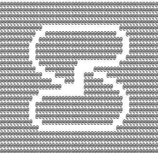
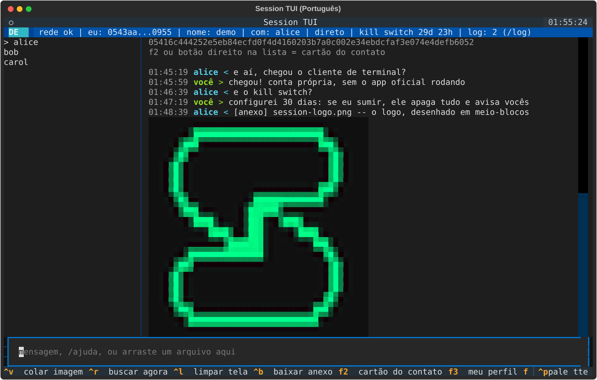
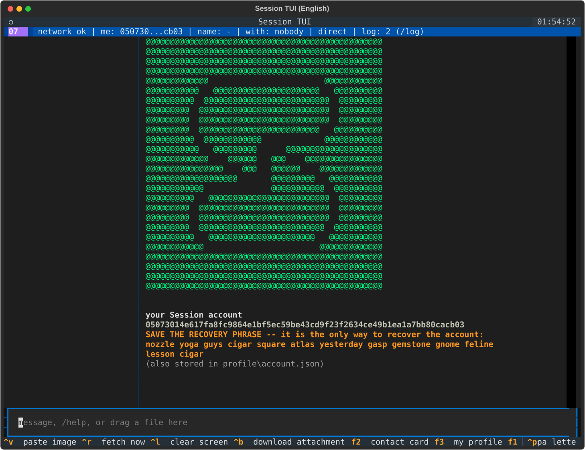
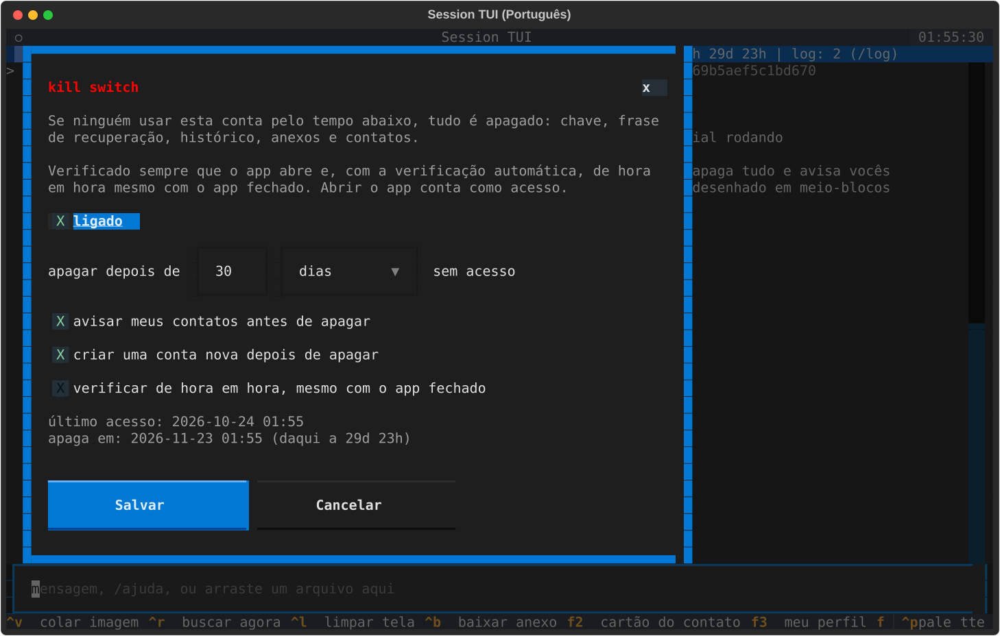
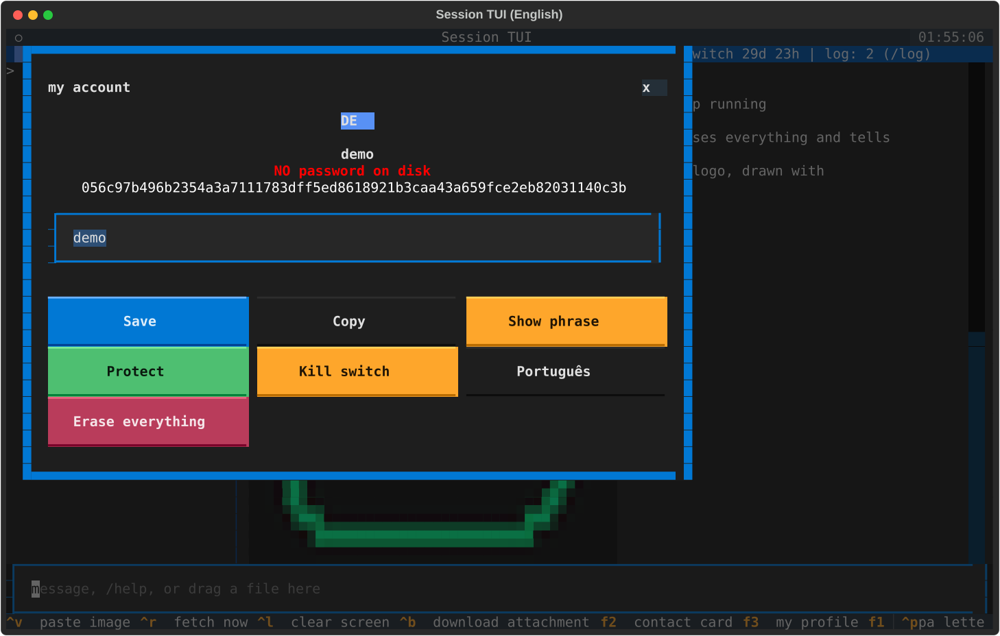
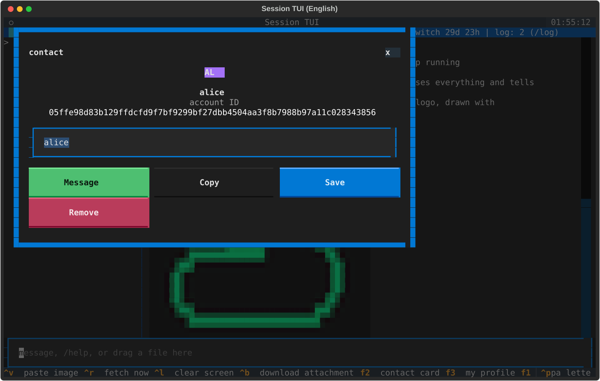
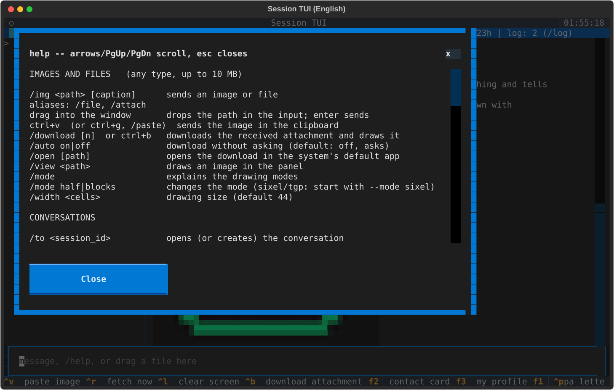
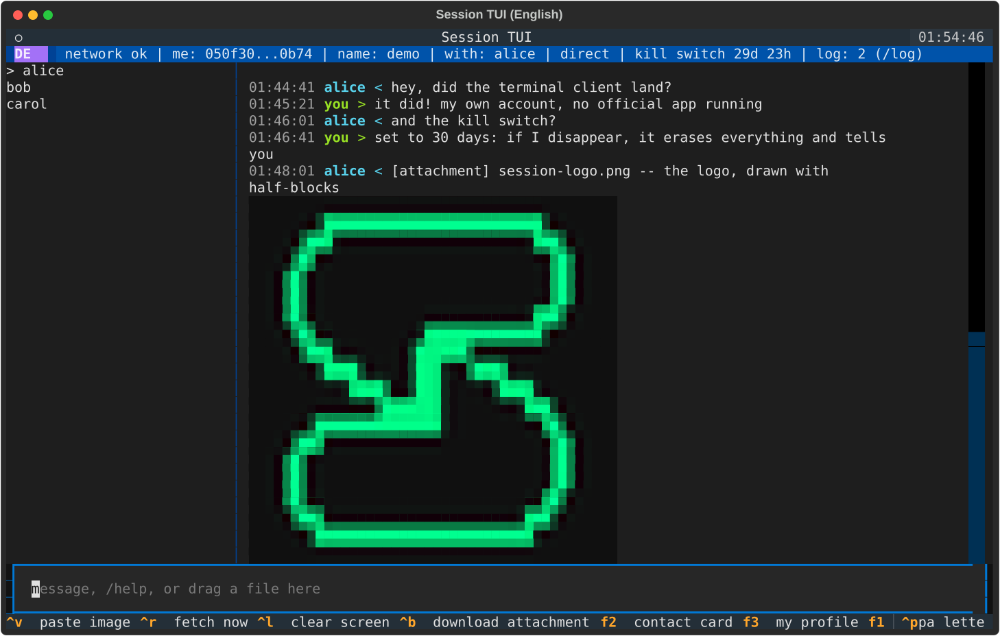
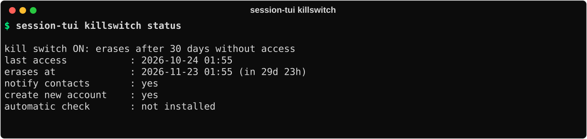
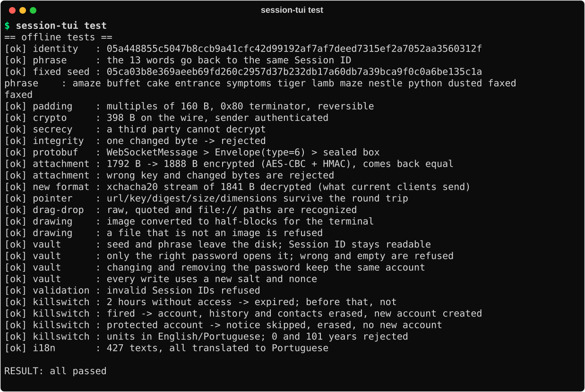

<p align="center">
  
</p>

<h1 align="center">Session TUI — Windows</h1>

<p align="center">
  Um cliente nativo do mensageiro <a href="https://getsession.org">Session</a> para o terminal.<br>
  Conta própria, criptografia ponta a ponta, imagens, onion routing e um kill switch configurável —<br>
  sem o aplicativo oficial rodando.
</p>

<p align="center">
  
  
  
  
  
</p>

<p align="center"><a href="README.md">English</a> · <b>Português</b> · <a href="https://github.com/ToDyNh0/SESSION-TUI_lnx">versão Linux</a></p>

> [!IMPORTANT]
> **Projeto não oficial.** O Session TUI é um cliente independente e educacional. Não tem vínculo,
> aval ou suporte do Session, da Session Technology Foundation nem dos projetos Oxen/OPTF. Ele
> conversa com a rede pública do Session usando o protocolo aberto; respeite os termos da rede e não
> use para spam.

<p align="center"></p>

## Sumário

- [Destaques](#destaques)
- [Capturas de tela](#capturas-de-tela)
- [Começo rápido](#começo-rápido)
- [Como usar](#como-usar)
- [Kill switch](#kill-switch)
- [Idioma](#idioma)
- [Proteção por senha](#proteção-por-senha)
- [Imagens e arquivos](#imagens-e-arquivos)
- [Onde ficam seus dados](#onde-ficam-seus-dados)
- [Modelo de segurança e limites](#modelo-de-segurança-e-limites)
- [Como funciona](#como-funciona)
- [Estrutura do projeto](#estrutura-do-projeto)
- [Testes](#testes)
- [Solução de problemas](#solução-de-problemas)

## Destaques

| | |
| --- | --- |
| **Conta própria** | As chaves são criadas na sua máquina (Ed25519 → X25519, Session ID `05…`). A frase de recuperação de 13 palavras usa o mesmo formato do app oficial. |
| **Criptografia ponta a ponta** | Caixa selada + assinatura Ed25519 do remetente, padding em blocos de 160 bytes — Session Protocol v2, 1-para-1. |
| **Direto ou onion** | Fala com os service nodes diretamente, ou por 3 saltos cifrados para que nenhum nó veja as duas pontas. |
| **Imagens e arquivos** | Até 10 MB, cifrados antes do upload. Lê os dois formatos de anexo (clássico AES-CBC+HMAC e o novo `crypto_secretstream`). As imagens são desenhadas **dentro do terminal**. |
| **Kill switch** | Depois de N horas / dias / meses / anos sem acesso, apaga tudo, pode avisar seus contatos e pode criar uma conta nova. |
| **Senha no disco** | Opcional: o seed é cifrado com Argon2id + XChaCha20-Poly1305. |
| **Inglês e português** | Inglês por padrão; um comando troca. |
| **Um arquivo só** | o `build.bat` (ou o Docker) gera um único `session-tui.exe` que roda sem Python. |
| **Feito para Windows** | Agendador de Tarefas para o kill switch, `icacls` no arquivo da chave, `clip.exe`, dados em `%APPDATA%`. |

## Capturas de tela

<table>
  <tr>
    <td width="50%"><br><sub><b>Primeira execução</b> — a conta é criada localmente e a frase aparece uma vez.</sub></td>
    <td width="50%"><br><sub><b>Kill switch</b> — tempo sem acesso, avisar contatos, conta nova, verificação automática.</sub></td>
  </tr>
  <tr>
    <td><br><sub><b>Meu perfil</b> (<kbd>F3</kbd>) — nome, Session ID, frase, senha, kill switch, idioma.</sub></td>
    <td><br><sub><b>Cartão do contato</b> (<kbd>F2</kbd>) — ID completo, apelido, copiar, remover.</sub></td>
  </tr>
  <tr>
    <td><br><sub><b>Ajuda</b> (<kbd>F1</kbd>) — todos os comandos, por seção.</sub></td>
    <td><br><sub><b>English</b> — o idioma padrão.</sub></td>
  </tr>
</table>

<p align="center"></p>

## Começo rápido

Você precisa de **um** destes: Python 3.10+ ou Docker. Mais nada.

### Opção A — gerar o `.exe` com um script

```bat
git clone https://github.com/ToDyNh0/SESSION-TUI_win.git
cd SESSION-TUI_win
build.bat test
```

O `build.bat` cria um ambiente virtual próprio (`.venv`), instala as dependências, roda os testes
offline (`test`) e gera **`dist\session-tui.exe`** — um arquivo só, que roda em qualquer Windows
10/11 de 64 bits sem Python. Copie para onde quiser e rode:

```powershell
.\dist\session-tui.exe            # abre a TUI
.\dist\session-tui.exe --help     # todos os comandos
```

### Opção B — gerar o `.exe` no Docker (sem Python na máquina)

```bash
docker build --output dist .
```

O [`Dockerfile`](Dockerfile) roda o Python de Windows dentro do Wine: instala as dependências, roda
todos os testes **com esse Python de Windows** e gera `dist/session-tui.exe`. Funciona a partir do
Windows (Docker Desktop, containers Linux), do Linux ou do macOS.

### Opção C — rodar do código-fonte, sem gerar nada

```bat
run.bat                       :: abre a TUI (a 1ª vez instala tudo em .venv)
run.bat send 05ab... "oi"     :: qualquer comando
```

## Como usar

Na primeira abertura uma conta nova é criada e a **frase de recuperação** aparece. Anote no papel:
ela *é* a conta.

Os exemplos abaixo usam `session-tui`; pelo código-fonte use `run.bat`.

Para usar a interface em português: `session-tui lang pt` (fica salvo).

### A TUI

```text
session-tui                    # abre a TUI (cria a conta na 1ª vez)
session-tui tui --to 05ab...   # já abre numa conversa
```

Cada contato tem **a sua própria tela**: trocar de conversa limpa o painel e redesenha só aquele
histórico. Mensagens de outra conversa não se misturam — viram um contador de não lidas na lista
(`alice (2)`) e uma notificação.

| Atalho | O que faz |
| --- | --- |
| <kbd>F1</kbd> | ajuda, numa janela rolável |
| <kbd>F2</kbd> / botão direito na lista | cartão do contato |
| <kbd>F3</kbd> / clique no seu avatar | seu perfil: nome, ID, frase, senha, kill switch, idioma |
| <kbd>Ctrl</kbd>+<kbd>R</kbd> | busca mensagens agora (também busca a cada 5 s) |
| <kbd>Ctrl</kbd>+<kbd>V</kbd> / <kbd>Ctrl</kbd>+<kbd>G</kbd> | envia a imagem da área de transferência |
| <kbd>Ctrl</kbd>+<kbd>B</kbd> | baixa o anexo recebido |
| <kbd>Ctrl</kbd>+<kbd>L</kbd> | limpa o painel |
| <kbd>Ctrl</kbd>+<kbd>C</kbd> | sai |

Qualquer linha que não comece com `/` é enviada como mensagem. Comandos (nomes em inglês e, entre
parênteses, os apelidos em português):

| Comando | O que faz |
| --- | --- |
| `/to <session_id>` (`/para`) | abre ou cria uma conversa |
| `/add <session_id>` | só adiciona à lista, sem trocar de tela |
| `/profile [id]` (`/perfil`) | cartão do contato |
| `/nick <nome>` (`/apelido`) · `/rm [id]` | apelido · remove da lista |
| `/name <nome>` (`/nome`) | seu nome de exibição, vai junto das mensagens |
| `/me` (`/eu`) · `/phrase` (`/frase`) | seu perfil · mostra a frase de recuperação |
| `/file <caminho> [legenda]` (`/img`, `/arquivo`) | envia uma imagem ou qualquer arquivo |
| `/download [n]` (`/baixar`) · `/auto on\|off` | baixa um anexo · baixa sem perguntar |
| `/open [caminho]` (`/abrir`) · `/view <caminho>` (`/ver`) | abre no programa padrão · desenha uma imagem |
| `/mode [half\|blocks]` (`/modo meio\|blocos`) · `/width <n>` (`/largura`) | modo de desenho · tamanho |
| `/protect` (`/proteger`) · `/unprotect` (`/desproteger`) | senha no seed |
| `/killswitch` (`/ks`) | configuração do kill switch |
| `/lang en\|pt` (`/idioma`) | idioma da interface |
| `/onion on\|off` · `/network` (`/rede`) | onion routing · diagnóstico da rede |
| `/log [n\|limpar]` · `/typing` (`/digitando`) | relato da rede · manda "digitando…" |
| `/removeall` | apaga tudo e começa uma conta nova (pede confirmação dupla) |
| `/help` (`/ajuda`) · `/quit` (`/sair`) | ajuda · sair |

### Linha de comando

Tudo funciona também sem a TUI — bom para scripts. Os nomes em português funcionam como apelidos.

| Comando | O que faz |
| --- | --- |
| `session-tui new` (`nova`) | cria uma conta e mostra a frase |
| `session-tui import "13 palavras"` (`importar`) | recupera uma conta |
| `session-tui me [--phrase]` (`eu`) | mostra seu Session ID (e a frase) |
| `session-tui send <id> "texto"` (`enviar`) | envia uma mensagem e sai |
| `session-tui file <id> foto.png [legenda]` (`imagem`) | envia uma imagem ou arquivo e sai |
| `session-tui listen [--once]` (`ouvir`) | imprime as mensagens que chegam, salvando anexos |
| `session-tui view foto.png` (`ver`) | desenha uma imagem no terminal |
| `session-tui network [--to <id>]` (`rede`) | nós, swarms e relógio da rede |
| `session-tui protect` / `unprotect` (`proteger` / `desproteger`) | senha no seed |
| `session-tui killswitch [on\|off\|status\|install\|uninstall\|check]` (`ks`) | kill switch |
| `session-tui lang [en\|pt]` (`idioma`) | idioma da interface |
| `session-tui test [--network]` (`testes`) | testes do protocolo (offline, ou ida e volta real) |

Opções gerais, aceitas antes ou depois do comando: `--profile PASTA`, `--onion`, `-v`,
`--password SENHA`, `--lang en|pt`.

## Kill switch

Se ninguém usar a conta pelo tempo que você escolher, **tudo é apagado**: a chave, a frase de
recuperação, o histórico, os anexos e a lista de contatos.

<p align="center"></p>

| Configuração | Opções |
| --- | --- |
| Tempo sem acesso | qualquer número de **horas, dias, meses ou anos** (de 1 hora a 100 anos) |
| Avisar meus contatos | antes de apagar, manda a cada contato `I am moving my account to:<ID novo>` — ou `This account is no longer in use.` quando nenhuma conta nova é criada (o texto é em inglês de propósito: quem recebe pode falar qualquer língua) |
| Criar conta nova | depois de apagar, cria uma conta nova na hora (a frase aparece na próxima vez que você abrir o app) |
| Verificação automática | verifica de hora em hora pelo **Agendador de Tarefas do Windows**, **mesmo com o app fechado** |

Pela TUI: <kbd>F3</kbd> → **Kill switch**, ou `/killswitch`. Pela linha de comando:

```bash
session-tui killswitch on --after 30 --unit dias --notify --new-account   # também instala a verificação de hora em hora
session-tui killswitch status
session-tui killswitch off                                                # também remove a verificação
```

`--unit` aceita `horas`, `dias`, `meses`, `anos` (e `hours`, `days`, `months`, `years`). Use
`--no-notify`, `--no-new-account` ou `--no-schedule` para desligar as opções.

**O que conta como acesso:** abrir a conta (a TUI ou qualquer comando que use a conta) e, com a TUI
aberta, usá-la — o relógio é renovado a cada poucos minutos. Só o dono muda a configuração: com a
conta protegida por senha, `killswitch on/off` pede a senha.

**Quando é verificado:** toda vez que o app abre (antes de qualquer outra coisa — nem um
`killswitch off` escapa de um prazo que já venceu) e, com a verificação automática instalada, de hora
em hora pelo agendador. Quando dispara, na próxima abertura o app conta o que aconteceu. Cada disparo
também fica registrado em `killswitch.log` na pasta do perfil (nunca a conta antiga).

**A verificação automática no Windows** é uma tarefa do Agendador de Tarefas chamada
`SessionTUI-killswitch-<id>`, só do seu usuário (sem direitos de administrador), de hora em hora,
também na bateria, e *oculta* — roda `conhost.exe --headless session-tui.exe killswitch check` (ou
`pythonw.exe main.py …` pelo código-fonte), então nenhuma janela pisca. Veja com
`schtasks /Query /TN SessionTUI-killswitch-<id>`.

> Se mover o `session-tui.exe` (ou a pasta do código) depois de instalar a verificação, rode
> `session-tui killswitch install` de novo para a tarefa apontar para o lugar novo.

> [!WARNING]
> **Limites — leia antes de confiar.**
> - Uma conta **protegida por senha não consegue avisar** os contatos quando o kill switch dispara:
>   a chave que assina o aviso está cifrada e o agendador não sabe a senha. Ela é apagada mesmo assim.
> - Quem **copiou** seus arquivos antes do prazo continua com a cópia.
> - Os arquivos são sobrescritos com bytes aleatórios antes de apagar, mas em SSD, sistemas de
>   arquivos com cópia (copy-on-write) ou pastas sincronizadas na nuvem isso não garante que os bytes
>   antigos sumiram.
> - Quem controla o computador pode mudar o relógio ou o arquivo de configuração.

## Idioma

O padrão é inglês. Para trocar — a escolha fica salva no perfil:

```bash
session-tui lang pt        # Português
session-tui lang en        # English
session-tui --lang pt me   # só nesta execução
```

Na TUI: `/idioma pt` ou o botão de idioma no seu perfil (<kbd>F3</kbd>). Menus e atalhos mudam na
próxima vez que o app abrir. As mensagens de erro da camada de rede também são traduzidas, e os
testes conferem que todo texto tem tradução para o português.

## Proteção por senha

A frase de recuperação **é** a conta: quem a tiver vira você. Por padrão ela fica em claro em
`account.json` (legível só pelo seu usuário do Windows: o arquivo recebe ACL própria via `icacls`). Para cifrar:

```bash
session-tui protect        # pergunta a senha (ou /proteger na TUI)
```

```text
senha --Argon2id(sal, 3 passes, 256 MB)--> chave de 32 B
seed + frase --XChaCha20-Poly1305(chave, nonce)--> bloco cifrado
```

Depois disso o `account.json` tem só o bloco cifrado, o sal, o nonce e os parâmetros do Argon2id. O
Session ID continua legível de propósito (é o seu endereço público). A TUI passa a pedir a senha ao
abrir; os comandos perguntam no terminal ou aceitam `--password` (que fica no histórico do shell —
prefira a pergunta). **Não há recuperação de senha**: só as 13 palavras trazem a conta de volta.
`session-tui unprotect` desfaz.

## Imagens e arquivos

| Ação | Como |
| --- | --- |
| enviar | arraste o arquivo para o terminal e dê Enter, ou `/file <caminho> [legenda]` |
| colar | copie uma imagem e aperte <kbd>Ctrl</kbd>+<kbd>V</kbd> (ou <kbd>Ctrl</kbd>+<kbd>G</kbd>) |
| receber | a conversa mostra nome, tamanho e dimensões e **pergunta**; <kbd>Ctrl</kbd>+<kbd>B</kbd> baixa |
| abrir | `/open` abre o último download no programa padrão |

Qualquer tipo de arquivo até 10 MB. Os arquivos são cifrados na sua máquina antes de chegar ao file
server, que só guarda bytes com cara de aleatórios por cerca de duas semanas.

| Modo de desenho | O que é | Onde |
| --- | --- | --- |
| `half` (padrão, `meio`) | dois pixels por célula com cores ANSI | qualquer terminal |
| `blocks` (`blocos`) | um pixel por célula | terminais que pintam mal o fundo |
| `sixel` | pixels de verdade, protocolo Sixel | Windows Terminal 1.22+, WezTerm |
| `tgp` | pixels de verdade, protocolo gráfico do Kitty | Kitty, Ghostty |
| `auto` | testa o terminal e escolhe | — |

`sixel`, `tgp` e `auto` precisam sondar o terminal antes de a interface abrir, por isso são
escolhidos na abertura: `session-tui tui --mode sixel`.

## Onde ficam seus dados

A pasta do perfil é **`%APPDATA%\SessionTUI\profile`** (escolha outra com `--profile PASTA`).

| Arquivo | Conteúdo |
| --- | --- |
| `account.json` | o seed da conta — **a chave privada** (cifrado se você usou `protect`) |
| `state.json` | contatos, apelidos, nome de exibição, posição da busca |
| `config.json` | idioma, kill switch e último acesso (fica quando tudo é apagado) |
| `history.jsonl` | histórico local das conversas (em claro) |
| `attachments/`, `enviados/` | arquivos baixados e colados |
| `snodes.json` | cache da lista de service nodes |
| `killswitch.log` | uma linha por disparo do kill switch |

Ela fica fora da pasta do programa e fora do OneDrive de propósito: uma pasta sincronizada mandaria sua chave privada para a nuvem.

## Modelo de segurança e limites

- O **conteúdo** é cifrado ponta a ponta; service nodes e file server só veem texto cifrado.
- **Modo direto:** o service node e o file server veem seu IP. **`--onion`:** nenhum nó vê as duas
  pontas, inclusive para anexos — ao custo de latência.
- Os certificados TLS dos service nodes são autoassinados, então o TLS não é verificado. A identidade
  real deles é a chave Ed25519/X25519 publicada na rede, que é para quem o modo onion cifra.
- `history.jsonl` e `attachments/` ficam em claro mesmo com senha. Enquanto o programa roda, a chave
  está na memória.
- Fora do escopo: grupos, communities, chamadas, sincronização de perfil/contatos entre aparelhos,
  mensagens que expiram e notificações push. Só conversas 1-para-1 com IDs `05…`.
- Escrever pela primeira vez para alguém que usa o app oficial chega como **solicitação de mensagem**,
  que a pessoa precisa aceitar.

## Como funciona

| Passo | Onde | O que acontece |
| --- | --- | --- |
| 1. Chaves | `session_native/keys.py`, `mnemonic.py` | seed de 16 B → Ed25519 → X25519; `Session ID = "05" + pubkey X25519`; frase de 13 palavras com checksum CRC-32 |
| 2. Service nodes | `session_native/snode.py` | `get_n_service_nodes` nos seed nodes → ~1.200 nós em cache; RPC em `POST /storage_rpc/v1` |
| 3. Onion routing | `session_native/onion.py` | 3 camadas XChaCha20-Poly1305, chave de salto `blake2b(X25519(a,B) ‖ A ‖ B)`, `POST /onion_req/v2` |
| 4. Swarm | `session_native/snode.py` | `get_swarm` → `store` (namespace 0) e `retrieve` assinado |
| Anexos | `session_native/attachments.py` | upload AES-256-CBC + HMAC-SHA256; download dos dois formatos, também por onion v4 |

A descrição completa do formato das mensagens, padding, assinaturas e anexos está em
**[docs/PROTOCOL.md](docs/PROTOCOL.md)** (em inglês).

## Estrutura do projeto

```text
main.py                    linha de comando (todos os comandos)
tui.py                     a interface ao vivo (Textual)
imgview.py                 desenho de imagens, área de transferência, caminhos arrastados
selftest.py                testes offline e a ida e volta pela rede real
build_exe.py               opções do PyInstaller usadas pelos scripts e pelo Docker
build.bat, run.bat           gera o .exe / roda pelo código-fonte
Dockerfile                 gera o .exe com o Python de Windows rodando no Wine
assets/                    logo (arte ASCII e imagem) e o ícone do .exe
docs/                      notas do protocolo e capturas de tela
session_native/
  sistema.py               tudo o que depende do sistema operacional (versão Windows)
  killswitch.py            kill switch: configuração, prazo, disparo
  i18n.py, traducao_pt.py  textos da interface: inglês e português
  cofre.py                 senha -> Argon2id -> XChaCha20 sobre o seed
  keys.py, mnemonic.py     seed, Ed25519/X25519, Session ID, frase de 13 palavras
  proto.py, wire.py        protobuf mínimo, padding, caixa selada, envelopes
  snode.py, onion.py       service nodes, swarms, requisições onion
  attachments.py           criptografia dos anexos e file server
  client.py                API de alto nível: send_text() / send_file() / poll()
  profile.py               conta, estado, configuração e histórico em disco
  logo.py                  o logo em ASCII
```

O código é idêntico em [SESSION-TUI_win](https://github.com/ToDyNh0/SESSION-TUI_win) e
[SESSION-TUI_lnx](https://github.com/ToDyNh0/SESSION-TUI_lnx), exceto `session_native/sistema.py` e
os arquivos de build.

## Testes

```bash
session-tui test            # offline: 25 verificações, poucos segundos
session-tui test --network  # mais uma ida e volta real: duas contas descartáveis trocam mensagem e imagem
```

<p align="center"></p>

Os testes offline cobrem a ida e volta frase ↔ Session ID, o padding, a autenticação do remetente,
que um terceiro não decifra, a detecção de adulteração, os números de campo do protobuf, os dois
formatos de anexo, os caminhos arrastados, o cofre de senha, o kill switch (disparo, aviso pulado com
senha, unidades, limites) e que todo texto da interface tem tradução. Os builds (`build.bat`
`test` e o Dockerfile) rodam os testes antes de gerar o executável.

## Solução de problemas

| Problema | Solução |
| --- | --- |
| *"O Windows protegeu o computador"* (SmartScreen) | O `.exe` não é assinado digitalmente. Clique em **Mais informações → Executar assim mesmo**, ou gere você mesmo pelo código — é o mesmo arquivo. |
| Um antivírus acusa o `.exe` | Executáveis do PyInstaller às vezes disparam heurísticas. O build **não** usa compressão UPX (um gatilho comum). Gere você mesmo, ou rode pelo código com `run.bat`. |
| <kbd>Ctrl</kbd>+<kbd>V</kbd> cola texto em vez da imagem | O Windows Terminal guarda o <kbd>Ctrl</kbd>+<kbd>V</kbd> para ele: use <kbd>Ctrl</kbd>+<kbd>G</kbd> ou `/colar`. |
| Botão direito cola em vez de abrir o cartão | O Windows Terminal usa o botão direito para colar: use <kbd>F2</kbd> ou `/perfil`. |
| O `build.bat` diz que falta Python | Instale o Python 3.10+ do python.org marcando *Add python.exe to PATH* (ou use o build no Docker). |
| Imagens de verdade (`--mode sixel`) | Precisa do Windows Terminal 1.22 ou mais novo; `half` funciona em qualquer lugar, `cmd.exe` incluído. |
| A conta estava na pasta antiga `session_profile` | Use com `--profile caminho\para\session_profile`, ou copie os arquivos para `%APPDATA%\SessionTUI\profile`. |

---

<p align="center">
  <br>
  <sub>Feito para estudo e uso pessoal. Session é marca registrada de seus respectivos donos.</sub>
</p>
